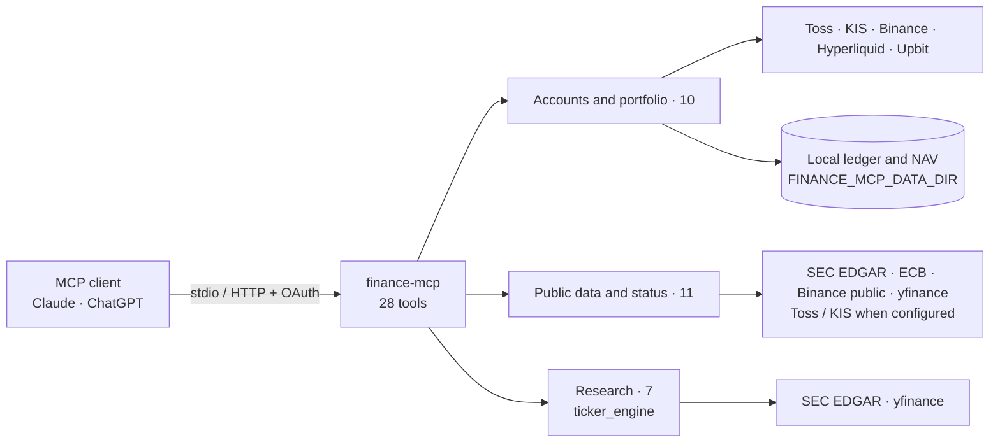

# finance-mcp

[한국어](README.md) · English

I built finance-mcp to bring my earlier [K-invest (InvestMCP)](https://github.com/ianlyoo/K-invest) and [Ticker Research](https://github.com/ianlyoo/ticker-research-mcp) projects into one read-only MCP server. It lets an AI chat client such as Claude or ChatGPT read your own brokerage and crypto futures accounts alongside public market data and ticker research for Korean and US securities and crypto futures.

The account and accounting engines come from InvestMCP 2.15.4. Research calculations come from the newer public Ticker Research fork, with SEC EDGAR and yfinance inputs. Finance and research keep their own SEC implementations to preserve their distinct fiscal-period, continuity and provenance safeguards. There is one process, one tool catalog, and one authentication boundary.

**Each user runs this server with their own keys for their own accounts. It is not a shared or hosted data service.** See [Configure your own accounts](#configure-your-own-accounts) for the provider terms.

I built this project by orchestrating Codex and Claude AI coding agents. The design, scope and acceptance decisions were mine; the agents implemented the code and ran the tests.

## Design principles

- **No order or transfer tools.** The server has no order submission, trade execution, cancellation, transfer or withdrawal capability. Historical records can describe those activities; they cannot initiate them.
- **Official APIs for accounts.** Account data comes from the Toss Securities Open API, the KIS Open API, Binance and the Hyperliquid information API. Public filings come from SEC EDGAR and FX from ECB reference rates. Unofficial Yahoo data (via yfinance) and the Upbit public-quotation API are labelled in the data source table.
- **Keys stay local.** The server reads process environment variables only and never loads `.env` files automatically. Broker keys are sent only to the corresponding broker for authentication.
- **Source and time on every section.** Account and market tools put the provider, the time the data describes (`as_of`, `as_of_basis`) and the observation time (`observed_at`) in each response section's `meta`. When the source time is unknown, `as_of` is null with a reason code. Research sections carry `as_of`, `as_of_basis` and `source`.
- **Missing is not zero.** Missing prices, incomplete history and unverified flows stay explicitly unavailable; they are not treated as zero.

## Start with synthetic accounts

Python 3.11 or newer is required. From a source checkout or unpacked source archive:

```bash
python -m pip install .
FINANCE_MCP_DEMO=1 python scripts/smoke.py
```

The smoke script starts the installed package over stdio, initializes an MCP client, lists tools, fetches a real ECB USD/KRW reference rate, and reads synthetic holdings and portfolio returns. It prints four PASS lines and exits nonzero on any failure. It creates and removes its own temporary data directory. No broker keys are needed.

```text
PASS start: stdio initialization
PASS list: 28 tools
PASS public: ECB USD/KRW reference rate
PASS demo: synthetic holdings and portfolio returns
```

For an isolated installation, first create a virtual environment with `python -m venv .venv` and activate it. With uv, the equivalent installation is:

```bash
uv venv
uv pip install --python .venv/bin/python .
FINANCE_MCP_DEMO=1 .venv/bin/python scripts/smoke.py
```

Run the server for an MCP client:

```bash
FINANCE_MCP_DEMO=1 finance-mcp
# Equivalent:
FINANCE_MCP_DEMO=1 python -m finance_mcp --transport stdio
```

Stdio waits for JSON-RPC messages; it is not an interactive shell. Logs go to stderr.

`FINANCE_MCP_DEMO=1` replaces account and portfolio responses with an invented portfolio: `DEMO-TOSS-1`, `DEMO-KIS-1`, synthetic KR/US securities, transactions and FX, and an empty synthetic Binance futures account. The same portfolio engine computes holdings, realized P&L, performance and concentration risk. Generated trades and 31 dated NAV observations cover a 30-day demonstration window, so `get_portfolio_returns` returns a non-empty result without prior collection. Account calls do not access brokers or the network in demo mode. Public-data and research calls still fetch public data. Demo NAV snapshots use a separate `demo` subdirectory. Statement imports require a configured real account; demo export returns a synthetic dataset without persisting it.

With demo mode off and no broker configured, account tools return `NOT_CONFIGURED` with the required variable names.

## Tools

There are 28 registered tools: 10 account/portfolio tools, 11 public-data/status tools, and 7 research tools. Stdio and HTTP expose the same curated catalog. [TOOLS.md](TOOLS.md) lists every tool and argument.

| Area | Count | Tools |
| --- | ---: | --- |
| Accounts and portfolio | 10 | `get_holdings`, `get_portfolio_summary`, `get_portfolio_returns`, `get_transactions`, `get_trading_pnl`, `get_crypto_positions`, `get_crypto_account_history`, `import_statement`†, `snapshot_portfolio_nav`†, `export_portfolio_dataset`† |
| Public data and status | 11 | `get_quote`, `get_candles`, `get_market_info`, `get_crypto_market`, `get_stock_snapshot`, `get_financials`, `get_key_metrics`, `get_sec_financials`, `get_ttm_financials`, `get_insider_trades`, `get_status` |
| Research | 7 | `get_ticker_research`, `get_ticker_research_status`, `plan_entry`, `compare_tickers`, `compare_price_performance`, `get_technical_indicators`, `get_eps_scenarios` |

† Explicitly marked local writers (statement import, NAV snapshot, dataset export). Account reads may also retain local observations for later accounting.

- `get_quote` and `get_portfolio_summary` expose the curated multi-symbol/section schemas. Legacy broker-specific names and compatibility aliases are internal helpers, absent from both discovery and invocation.
- Use `compare_price_performance` for price-history comparison; it replaces the former `get_market_series` surface.
- `plan_entry` and `compare_tickers` calculate scenarios from amounts you supply; they never submit an order.
- General quotes and candles fall back to yfinance when Toss is not configured. Optional broker sections (depth, price limits, market calendar and broker quote comparison) require your broker's official API credentials and may be unavailable. Composite tools label partial coverage explicitly.
- For a no-key FX request, call `get_market_info` with `include` set to `["fx"]`.

## Local clients

Use an absolute path to the installed executable so desktop clients can find the environment. In Claude Desktop's MCP configuration:

```json
{
  "mcpServers": {
    "finance": {
      "command": "/absolute/path/to/.venv/bin/finance-mcp",
      "args": ["--transport", "stdio"],
      "env": {"FINANCE_MCP_DEMO": "1"}
    }
  }
}
```

For Claude Code, the same `mcpServers` object can be used in a project `.mcp.json`. Alternatively register the executable using Claude Code's MCP setup. Keep any real credentials in your process environment or local secret manager, outside a shared project configuration. See the [MCP local-client guide](https://modelcontextprotocol.io/docs/develop/build-server) for configuration locations.

## HTTP and OAuth

HTTP is opt-in and refuses to start without `MCP_AUTH_TOKEN`. Its default bind address is loopback and its default port is 18800. Set a strong random token through the environment, then run:

```bash
finance-mcp --transport streamable-http --host 127.0.0.1 --port 18800
```

The endpoint is `/mcp`. A client supporting direct bearer authentication sends `Authorization: Bearer` with the configured token. This token is for the MCP server, separate from broker credentials.

For remote connectors, terminate HTTPS at a reverse proxy and forward the entire server origin, including `/mcp`, OAuth metadata, `/register`, `/authorize`, `/token` and `/revoke`. Set `MCP_PUBLIC_URL` to your public HTTPS origin (for example `https://finance.example.com`); the same origin is the advertised OAuth resource identifier. Preserve the Host, Origin and Authorization headers. Do not expose the backend port directly. The application includes host validation and disables proxy-header trust.

Enable OAuth by setting `MCP_OAUTH_ENABLED=1` and `MCP_OAUTH_APPROVAL_HASH`. Generate the hash locally with:

```bash
python -m finance_mcp.consent_gate hash
```

The command reads the approval passphrase without echoing it and prints its scrypt hash. Store that hash in `MCP_OAUTH_APPROVAL_HASH`, separate from `MCP_AUTH_TOKEN`. Restart the server after configuration changes. The consent page requires your approval passphrase before issuing a code. Never enter broker credentials in that page.

OAuth includes discovery, dynamic client registration, authorization-code flow with PKCE S256, consent binding, access-token expiry, refresh rotation and revocation, and persistent hashed token state. Default redirect origins are the supported Claude and ChatGPT HTTPS origins. `CONSENT_GATE_REDIRECT_ORIGINS` accepts a JSON list of exact HTTPS origins if your connector requires another callback origin. A manually registered client can instead use `MCP_OAUTH_CLIENT_ID` and `MCP_OAUTH_CLIENT_SECRET`; dynamic registration does not require them. OAuth does not disable direct bearer access.

- In claude.ai, add a custom remote connector pointing to `https://finance.example.com/mcp`, then complete the OAuth consent flow. Availability depends on your account and workspace policy. See [Claude custom connectors](https://support.claude.com/en/articles/11175166-getting-started-with-custom-connectors-using-remote-mcp).
- In ChatGPT's custom MCP/plugin connection interface, enter the HTTPS `/mcp` URL and choose OAuth with dynamic client registration, then connect and complete consent. The server does not advertise client metadata document registration. See [Connect and test](https://developers.openai.com/plugins/deploy/connect-chatgpt) and [OAuth authentication](https://developers.openai.com/plugins/build/auth) for current UI and account requirements.

Broker keys stay on the machine running the server and are sent only to the corresponding broker for authentication. Connected clients receive the tool results you request, which may include financial account data. This is a single-user server: anyone authorized with its bearer token or consented OAuth access can read that user's configured accounts.

## Configure your own accounts

Each user runs this server with their own keys for their own accounts. It is not a shared or hosted data service. Toss and KIS terms prohibit key sharing and third-party quote distribution; do not proxy other users through your keys. See the [Toss Open API terms](https://home.tossinvest.com/ko/terms/v2?id=752) and [KIS individual-customer terms](https://file.koreainvestment.com/Storage/customer/guide/regards/openAPI_service_customer.html).

The server reads process environment variables only. It does not automatically load `.env` files. [.env.example](.env.example) lists names with empty values; supply your own values through your launcher or secret manager.

- **Toss Securities.** Obtain your own Open API credentials in Toss WTS → settings → Open API and set `TOSS_CLIENT_ID` and `TOSS_CLIENT_SECRET`. For multiple accounts, `TOSS_ACCOUNTS_JSON` accepts a JSON object containing an `accounts` array. Each account object has `label`, `client_id`, and `client_secret`; optional `account_id` keeps ledger identity stable when a label changes. A single account object is also accepted. This is local configuration, not a broker API response.
- **Korea Investment & Securities.** Obtain credentials through the [official API portal](https://apiportal.koreainvestment.com/), then set `KIS_APP_KEY`, `KIS_APP_SECRET`, `KIS_CANO`, and optionally `KIS_ACNT_PRDT_CD`. `KIS_ACCOUNTS_JSON` provides multiple account objects with `label`, `app_key`, `app_secret`, `cano`, and `acnt_prdt_cd`.
- **Binance.** For futures account data, use your own read-only key with `BINANCE_API_KEY` and `BINANCE_API_SECRET`. An RSA key can instead be supplied as PEM text in `BINANCE_SIGNING_KEY`. Disable trading and withdrawal permissions on the key. Binance public market tools need no key.
- **Hyperliquid.** Optional reads use account addresses supplied by you, via the official information API; no signing key is accepted.
- **SEC.** SEC tools use a generic default User-Agent, `finance-mcp/0.1.0 (contact: you@example.com)`, so installation and public tools need no secret. Override `SEC_USER_AGENT` with your application identifier and genuine contact before sustained SEC use. SEC may refuse requests without an acceptable contact or from restricted networks.

All ledger, NAV, OAuth, token and local cache state belongs under `FINANCE_MCP_DATA_DIR`, default `~/.finance-mcp`. Keep this directory private and back it up if you need historical returns. Statement PDFs must be placed in its `statements/inbox` directory; tools accept bare filenames and reject path traversal and symlinks. No statements, account databases or personal fixtures ship with this repository.

## Environment variables

Names and purposes only; values are intentionally omitted.

| Name | Purpose |
| --- | --- |
| `FINANCE_MCP_DEMO` | Serve account and portfolio tools from the synthetic demo portfolio |
| `FINANCE_MCP_DATA_DIR` | Directory for ledger, NAV, OAuth, token and cache state |
| `FINANCE_MCP_TRANSPORT` | Default transport (`stdio` or `streamable-http`) |
| `FINANCE_MCP_HOST` | HTTP bind address |
| `FINANCE_MCP_PORT` | HTTP port |
| `FINANCE_MCP_LEDGER_FULL_BACKFILL` | Re-read every history window from the broker on each request |
| `TOSS_CLIENT_ID` | Toss Securities Open API client ID |
| `TOSS_CLIENT_SECRET` | Toss Securities Open API client secret |
| `TOSS_ACCOUNTS_JSON` | Multiple Toss accounts as JSON |
| `KIS_APP_KEY` | KIS app key |
| `KIS_APP_SECRET` | KIS app secret |
| `KIS_CANO` | KIS account number (CANO) |
| `KIS_ACNT_PRDT_CD` | KIS account product code |
| `KIS_ACCOUNTS_JSON` | Multiple KIS accounts as JSON |
| `KIS_MIN_REQUEST_INTERVAL` | Minimum seconds between KIS requests |
| `KIS_RATE_LIMIT_RETRIES` | Retries after a KIS rate-limit response (at most 2) |
| `KIS_HISTORY_MAX_PAGES` | Maximum pages per KIS history read |
| `BINANCE_API_KEY` | Binance read-only API key |
| `BINANCE_API_SECRET` | Binance API secret |
| `BINANCE_SIGNING_KEY` | Binance RSA signing key as PEM text, instead of the secret |
| `HYPERLIQUID_ACCOUNT_ADDRESSES` | Your Hyperliquid account addresses, comma-separated |
| `SEC_USER_AGENT` | SEC request User-Agent with your application identifier and contact |
| `TICKER_TECHNICAL_ENABLED` | Turn technical factors in `get_ticker_research` on or off |
| `MCP_AUTH_TOKEN` | HTTP bearer token; required for HTTP |
| `MCP_PUBLIC_URL` | Public HTTPS origin; also the OAuth resource identifier |
| `MCP_OAUTH_ENABLED` | Enable OAuth |
| `MCP_OAUTH_APPROVAL_HASH` | scrypt hash of the consent-page approval passphrase |
| `MCP_OAUTH_CLIENT_ID` | Manually registered OAuth client ID |
| `MCP_OAUTH_CLIENT_SECRET` | Manually registered OAuth client secret |
| `MCP_OAUTH_STATIC_CLIENT_ENABLED` | Allow the manually registered client |
| `MCP_OAUTH_CLIENT_CAP` | Maximum number of dynamically registered clients |
| `MCP_OAUTH_TOKEN_TTL` | Access-token lifetime in seconds |
| `MCP_OAUTH_REFRESH_TOKEN_TTL` | Refresh-token lifetime in seconds |
| `MCP_OAUTH_REFRESH_GRACE_SECONDS` | Seconds a rotated refresh token may be replayed; later replay revokes the token family |
| `CONSENT_GATE_REDIRECT_ORIGINS` | JSON list of exact HTTPS OAuth redirect origins |

## Data sources and limits

| Source | Status | Used for |
| --- | --- | --- |
| [Toss Securities Open API](https://openapi.tossinvest.com) | Official, your API keys | Accounts, holdings, historical executions, broker market inquiries |
| [KIS Open API](https://apiportal.koreainvestment.com/) | Official, your API keys | Accounts, KR/overseas balances, quotes and history |
| [Binance REST API](https://developers.binance.com/docs/derivatives/usds-margined-futures/general-info) | Official; public reads or your read-only account keys | Futures market and account data |
| [Hyperliquid information API](https://hyperliquid.gitbook.io/hyperliquid-docs/for-developers/api/info-endpoint) | Official public address-based information | Optional futures account reads |
| [Upbit quotation API](https://docs.upbit.com/kr/reference/list-tickers) | Public-quotation API, no keys; terms: see provider | KRW stablecoin marks for crypto NAV observations |
| [SEC EDGAR](https://www.sec.gov/search-filings/edgar-application-programming-interfaces) | Official public filings | Financial facts, TTM, insider filings, EPS history |
| [ECB reference rates](https://www.ecb.europa.eu/stats/policy_and_exchange_rates/euro_reference_exchange_rates/html/index.en.html) | Official public daily reference data | No-key FX; informational, not executable prices |
| [yfinance](https://github.com/ranaroussi/yfinance) | Apache-2.0 library; unofficial Yahoo data; terms: see provider | No-key quotes/candles, financial metrics, consensus, technical research, Treasury yield proxy |

Yahoo data terms: [see provider](https://legal.yahoo.com/us/en/yahoo/terms/product-atos/apiforydn/index.html). Upbit data terms: [see provider](https://www.upbit.com/open_api_agreement). This repository contains no recorded Yahoo responses or broker sample-code fixtures.

Public services can rate-limit, delay or restrict data by region. Yahoo is not an official exchange API. Price-return charts exclude dividends unless stated; provisional prices and incomplete coverage are labelled. Entry and EPS scenarios are calculations, not predictions. Local performance estimates depend on complete trade history, reliable FX and external-flow evidence.

## Architecture



| Path | Contents |
| --- | --- |
| `finance_mcp/` | Server, transports, OAuth, account/portfolio engine, finance SEC and public-data helpers, demo portfolio |
| `ticker_engine/` | Research providers and calculations, mounted into the same server |
| `scripts/smoke.py` | Online stdio smoke check |
| `tests/` | Synthetic-data unit tests |
| `TOOLS.md` | Every tool and argument |
| `.env.example` | Environment variable names with empty values |

Only `finance_mcp` and `ticker_engine` are installed as importable project packages. Research uses the unified transport's authentication and does not need a separate service-token file.

## Development

```bash
python -m pip install '.[dev]'
python -m pytest -q
ruff check .
```

Unit tests use synthetic inputs, temporary data directories, and blocked network transports. At the initial public release, all 947 tests passed on Linux with Python 3.14. The smoke script is the separate online check. Dependency lower bounds follow the reference project; Python's resolver selects compatible releases. [THIRD_PARTY_NOTICES.md](THIRD_PARTY_NOTICES.md) records the installed runtime license audit.

## License

MIT — Copyright (c) 2026 ianlyoo. See [LICENSE](LICENSE) and [THIRD_PARTY_NOTICES.md](THIRD_PARTY_NOTICES.md).

This software and its output are for information only and are not investment advice.
