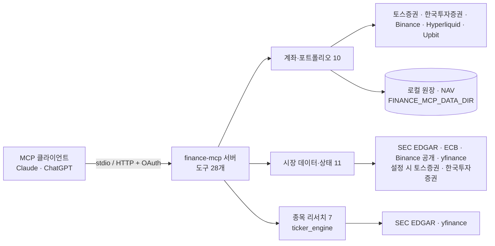

# finance-mcp

**English abstract.** finance-mcp is a read-only MCP server that lets an individual investor ask an AI chat client such as Claude or ChatGPT about their own brokerage and crypto futures accounts together with public market data and ticker research. It merges my earlier K-invest (InvestMCP) and Ticker Research projects into one process with 28 tools: 10 account/portfolio, 11 public-data/status and 7 research. Account data comes only from official APIs (Toss Securities, Korea Investment & Securities, Binance, Hyperliquid), filings from SEC EDGAR, and unofficial Yahoo data via yfinance is labelled as such; there are no order or transfer tools. Each user runs it locally with their own keys for their own accounts; it is not a shared or hosted data service. Full English documentation: [README.en.md](README.en.md).

## 무엇인가

개인 투자자가 Claude·ChatGPT 같은 AI 채팅에서 자기 증권·크립토 계좌와 공개 시장 데이터를 한곳에서 묻는 **읽기 전용** MCP 서버다. 국내·미국 주식과 크립토 선물을 다룬다. "내 보유 종목이 코스피 대비 어떤가"라는 질문에는 `get_holdings`로 종목을 읽고 `compare_price_performance`로 비교한다. "이 종목의 TTM 실적과 최근 내부자 거래는"이라는 질문에는 SEC 공시 도구를 쓴다.

이전에 만든 두 프로젝트 [K-invest (InvestMCP)](https://github.com/ianlyoo/K-invest)와 [Ticker Research](https://github.com/ianlyoo/ticker-research-mcp)를 하나로 합쳤다. 계좌·회계 엔진은 InvestMCP 2.15.4에서, 리서치 계산은 Ticker Research의 최신 공개 포크에서 가져왔다. 프로세스 하나, 도구 카탈로그 하나, 인증 경계 하나다. SEC 구현은 합치지 않았다. 재무 도구와 리서치 도구는 회계 기간·연속성·출처 검증 장치가 서로 달라서 각자 자기 구현을 쓴다.

**각 사용자가 자기 키로 자기 계좌만 조회하도록 직접 실행한다. 공유하거나 남에게 시세를 제공하는 호스팅 데이터 서비스가 아니다.** 근거가 되는 약관은 [내 계좌 설정](#내-계좌-설정)에 있다.

이 프로젝트는 Codex와 Claude AI 코딩 에이전트를 오케스트레이션해 만들었다. 설계, 범위, 채택과 공개 결정은 내가 내렸고, 에이전트가 구현과 테스트 실행을 맡았다.

## 설계 원칙

- **주문·이체 도구가 없다.** 주문 제출, 체결, 취소, 이체, 출금 기능이 없다. 거래 이력은 읽지만 거래를 일으키지 못한다.
- **계좌는 공식 API로만 읽는다.** 토스증권 Open API, 한국투자증권 Open API, Binance, Hyperliquid 공식 API를 쓴다. 공시는 SEC EDGAR, 환율은 ECB 기준환율이다. 비공식 출처인 yfinance(Yahoo 데이터)와 공개 시세 API인 Upbit은 [데이터 출처](#데이터-출처) 표에 구분해 적었다.
- **키는 사용자 기기의 환경 변수에만 둔다.** 서버는 프로세스 환경 변수만 읽고 `.env` 파일을 자동으로 불러오지 않는다. 브로커 키는 해당 브로커 인증에만 보낸다.
- **숫자에는 출처와 기준 시각이 붙는다.** 계좌·시장 도구는 응답 섹션마다 `meta`에 출처(`provider`), 데이터 기준 시각(`as_of`, `as_of_basis`), 조회 시각(`observed_at`)을 넣는다. 기준 시각을 알 수 없으면 `as_of`를 null로 두고 이유 코드를 남긴다. 리서치 도구도 섹션마다 `as_of`, `as_of_basis`, `source`를 붙인다.
- **없는 데이터는 0이 아니다.** 가격 누락, 불완전한 이력, 확인되지 않은 입출금은 unavailable로 남기고 0으로 채우지 않는다. 계좌를 설정하지 않았으면 `NOT_CONFIGURED`와 필요한 변수 이름을 돌려준다.

## 데이터 출처

| 출처 | 구분 | 키 | 용도 |
|---|---|---|---|
| [토스증권 Open API](https://openapi.tossinvest.com) | 공식 | 본인 키 필요 | 계좌, 보유 종목, 체결 이력, 브로커 시세 조회 |
| [한국투자증권 Open API](https://apiportal.koreainvestment.com/) | 공식 | 본인 키 필요 | 계좌, 국내·해외 잔고, 시세와 이력 |
| [Binance REST API](https://developers.binance.com/docs/derivatives/usds-margined-futures/general-info) | 공식 | 시장 데이터는 불필요, 계좌는 본인 읽기 전용 키 | 선물 시장·계좌 데이터 |
| [Hyperliquid info API](https://hyperliquid.gitbook.io/hyperliquid-docs/for-developers/api/info-endpoint) | 공식, 주소 기반 공개 조회 | 불필요 (본인 주소 입력) | 선택적 선물 계좌 조회 |
| [Upbit 시세 API](https://docs.upbit.com/kr/reference/list-tickers) | 공개 시세 API; terms: see provider | 불필요 | 크립토 NAV 관측용 KRW 스테이블코인 가격 |
| [SEC EDGAR](https://www.sec.gov/search-filings/edgar-application-programming-interfaces) | 공식 공개 공시 | 불필요 | 재무 사실, TTM, 내부자 거래, EPS 이력 |
| [ECB 기준환율](https://www.ecb.europa.eu/stats/policy_and_exchange_rates/euro_reference_exchange_rates/html/index.en.html) | 공식 공개 일별 기준값 | 불필요 | 키 없는 환율. 참고용이며 체결 가격이 아니다 |
| [yfinance](https://github.com/ranaroussi/yfinance) | Apache-2.0 라이브러리, **비공식** Yahoo 데이터; terms: see provider | 불필요 | 키 없는 시세·캔들, 재무 지표, 컨센서스, 기술적 리서치, 미 국채 수익률 대용 |

Yahoo 데이터 약관: [see provider](https://legal.yahoo.com/us/en/yahoo/terms/product-atos/apiforydn/index.html). Upbit 데이터 약관: [see provider](https://www.upbit.com/open_api_agreement). 이 저장소에는 Yahoo 응답 녹화본이나 브로커 샘플 코드 픽스처가 없다.

공개 서비스는 요청을 제한하거나 지연하거나 지역에 따라 막을 수 있다. Yahoo는 공식 거래소 API가 아니다. 가격 수익률 차트는 따로 밝히지 않는 한 배당을 빼고 계산하며, 잠정 가격과 불완전한 구간은 표시한다. 분할 매수와 EPS 시나리오는 계산이지 예측이 아니다. 로컬 성과 추정은 거래 이력의 완전성, 환율의 신뢰성, 외부 입출금 근거에 달려 있다.

## 도구 28개

stdio와 HTTP가 같은 28개 도구를 노출한다. 모든 인자와 설명은 [TOOLS.md](TOOLS.md)에 있다.

| 영역 | 개수 | 도구 |
|---|---:|---|
| 계좌·포트폴리오 | 10 | `get_holdings`, `get_portfolio_summary`, `get_portfolio_returns`, `get_transactions`, `get_trading_pnl`, `get_crypto_positions`, `get_crypto_account_history`, `import_statement`†, `snapshot_portfolio_nav`†, `export_portfolio_dataset`† |
| 시장 데이터·상태 | 11 | `get_quote`, `get_candles`, `get_market_info`, `get_crypto_market`, `get_stock_snapshot`, `get_financials`, `get_key_metrics`, `get_sec_financials`, `get_ttm_financials`, `get_insider_trades`, `get_status` |
| 종목 리서치 | 7 | `get_ticker_research`, `get_ticker_research_status`, `plan_entry`, `compare_tickers`, `compare_price_performance`, `get_technical_indicators`, `get_eps_scenarios` |

† local write로 표시한 도구다. 명세서 가져오기, NAV 스냅샷, 데이터셋 내보내기를 로컬 데이터 디렉터리에 기록한다. 계좌 조회도 나중의 회계 계산을 위해 관측값을 로컬에 남길 수 있다.

- `get_quote`와 `get_portfolio_summary`는 여러 종목·섹션을 한 번에 받는 스키마다. 브로커별 옛 도구 이름과 호환 별칭은 내부 함수로만 남겼고, 목록에도 나오지 않고 호출도 거부된다.
- 가격 이력 비교는 `compare_price_performance`가 맡는다. 예전 `get_market_series`를 대체했다.
- `plan_entry`와 `compare_tickers`는 사용자가 넣은 금액으로 시나리오를 계산할 뿐 주문을 내지 않는다.
- 토스증권을 설정하지 않으면 일반 시세와 캔들은 yfinance로 대체한다. 호가, 가격 제한, 장 운영 일정, 브로커 간 시세 비교 같은 선택 섹션은 본인 브로커 키가 있어야 하며 없으면 unavailable이다. 여러 출처를 합치는 도구는 부분 커버리지를 명시한다.
- 키 없이 환율을 보려면 `get_market_info`에 `include`를 `["fx"]`로 넘긴다.

## 빠른 시작

Python 3.11 이상이 필요하다. 소스 체크아웃이나 압축을 푼 소스 디렉터리에서 설치하고 데모 모드로 스모크 검사를 돌린다.

```bash
python -m pip install .
FINANCE_MCP_DEMO=1 python scripts/smoke.py
```

`scripts/smoke.py`는 설치된 패키지를 stdio로 띄워 MCP 클라이언트로 초기화하고, 도구 목록이 28개인지 확인하고, ECB의 실제 USD/KRW 기준환율을 받고, 합성 계좌의 보유 종목과 포트폴리오 수익률을 읽는다. 임시 데이터 디렉터리를 만들었다가 지우며 브로커 키는 필요 없다. 환율 단계에는 인터넷 연결이 필요하다. 성공하면 PASS 네 줄을 출력하고, 하나라도 실패하면 0이 아닌 코드로 끝난다.

```text
PASS start: stdio initialization
PASS list: 28 tools
PASS public: ECB USD/KRW reference rate
PASS demo: synthetic holdings and portfolio returns
```

가상 환경에 설치하려면 먼저 `python -m venv .venv`로 만들고 활성화한다. uv로는 다음과 같다.

```bash
uv venv
uv pip install --python .venv/bin/python .
FINANCE_MCP_DEMO=1 .venv/bin/python scripts/smoke.py
```

MCP 클라이언트용으로 서버를 띄운다.

```bash
FINANCE_MCP_DEMO=1 finance-mcp
# 같은 동작:
FINANCE_MCP_DEMO=1 python -m finance_mcp --transport stdio
```

stdio는 JSON-RPC 메시지를 기다린다. 대화형 셸이 아니다. 로그는 stderr로 나간다.

**데모 모드.** `FINANCE_MCP_DEMO=1`이면 계좌·포트폴리오 응답이 가상 포트폴리오로 바뀐다. `DEMO-TOSS-1`, `DEMO-KIS-1` 계좌, 합성 국내·미국 종목과 거래, 환율, 빈 합성 Binance 선물 계좌다. 실제 계좌와 같은 포트폴리오 엔진이 보유 종목, 실현 손익, 성과, 집중도 위험을 계산한다. 생성된 거래와 31개 일별 NAV 관측이 30일 구간을 채우므로, 미리 수집하지 않아도 `get_portfolio_returns`가 비어 있지 않은 결과를 돌려준다. 데모 모드의 계좌 호출은 브로커나 네트워크에 접근하지 않는다. 공개 데이터·리서치 도구는 그대로 공개 데이터를 받아온다. 데모 NAV 스냅샷은 별도 `demo` 하위 디렉터리에 저장한다. 명세서 가져오기는 실제 계좌 설정이 있어야 하고, 데모 내보내기는 합성 데이터셋을 저장하지 않고 돌려준다.

## 연결

### Claude Desktop · Claude Code (stdio)

데스크톱 클라이언트가 환경을 찾을 수 있도록 설치된 실행 파일의 절대 경로를 쓴다. Claude Desktop MCP 설정은 다음과 같다.

```json
{
  "mcpServers": {
    "finance": {
      "command": "/absolute/path/to/.venv/bin/finance-mcp",
      "args": ["--transport", "stdio"],
      "env": {"FINANCE_MCP_DEMO": "1"}
    }
  }
}
```

Claude Code에서는 같은 `mcpServers` 객체를 프로젝트 `.mcp.json`에 넣거나, Claude Code의 MCP 설정으로 실행 파일을 등록한다. 실제 키는 공유되는 프로젝트 설정이 아니라 프로세스 환경이나 로컬 비밀 관리자에 둔다. 설정 파일 위치는 [MCP 로컬 클라이언트 가이드](https://modelcontextprotocol.io/docs/develop/build-server)를 따른다.

### claude.ai · ChatGPT 원격 커넥터 (HTTP + OAuth)

HTTP는 선택 사항이며 `MCP_AUTH_TOKEN`이 없으면 시작하지 않는다. 기본 바인드 주소는 루프백, 기본 포트는 18800이다. 강한 무작위 토큰을 환경 변수로 넣고 실행한다.

```bash
finance-mcp --transport streamable-http --host 127.0.0.1 --port 18800
```

엔드포인트는 `/mcp`다. 직접 베어러 인증을 지원하는 클라이언트는 설정한 토큰을 `Authorization: Bearer`로 보낸다. 이 토큰은 MCP 서버용이며 브로커 키와 별개다.

원격 커넥터는 리버스 프록시에서 HTTPS를 종료하고 서버 오리진 전체를 넘긴다. `/mcp`, OAuth 메타데이터, `/register`, `/authorize`, `/token`, `/revoke`가 모두 포함된다. `MCP_PUBLIC_URL`에 공개 HTTPS 오리진(예: `https://finance.example.com`)을 넣으면 같은 오리진이 OAuth 리소스 식별자로 광고된다. Host, Origin, Authorization 헤더를 보존하고 백엔드 포트를 직접 노출하지 않는다. 서버는 Host를 검증하고 프록시 헤더를 신뢰하지 않는다.

OAuth는 `MCP_OAUTH_ENABLED=1`과 `MCP_OAUTH_APPROVAL_HASH`로 켠다. 해시는 로컬에서 만든다.

```bash
python -m finance_mcp.consent_gate hash
```

이 명령은 승인 암호를 화면에 표시하지 않고 읽어 scrypt 해시를 출력한다. 그 해시를 `MCP_AUTH_TOKEN`과 별도로 `MCP_OAUTH_APPROVAL_HASH`에 넣고, 설정을 바꾼 뒤에는 서버를 재시작한다. 동의 페이지는 인가 코드를 발급하기 전에 승인 암호를 요구한다. 이 페이지에 브로커 키를 넣지 않는다.

OAuth는 디스커버리, 동적 클라이언트 등록, PKCE S256 인가 코드 흐름, 동의 바인딩, 액세스 토큰 만료, 리프레시 토큰 회전과 폐기, 해시로 저장하는 토큰 상태를 지원한다. 기본 리다이렉트 오리진은 Claude와 ChatGPT의 HTTPS 오리진이다. 커넥터가 다른 콜백 오리진을 쓰면 `CONSENT_GATE_REDIRECT_ORIGINS`에 정확한 HTTPS 오리진의 JSON 목록을 넣는다. 수동 등록 클라이언트는 `MCP_OAUTH_CLIENT_ID`와 `MCP_OAUTH_CLIENT_SECRET`을 쓰고, 동적 등록에는 둘 다 필요 없다. OAuth를 켜도 직접 베어러 접근은 유지된다.

- **claude.ai:** `https://finance.example.com/mcp`를 가리키는 사용자 지정 원격 커넥터를 추가하고 OAuth 동의를 마친다. 사용 가능 여부는 계정과 워크스페이스 정책에 따른다. [Claude custom connectors](https://support.claude.com/en/articles/11175166-getting-started-with-custom-connectors-using-remote-mcp) 참고.
- **ChatGPT:** 사용자 지정 MCP/플러그인 연결 화면에 HTTPS `/mcp` URL을 넣고, 동적 클라이언트 등록 방식의 OAuth를 골라 연결한 뒤 동의를 마친다. 서버는 클라이언트 메타데이터 문서 등록을 광고하지 않는다. 현재 화면과 계정 요건은 [Connect and test](https://developers.openai.com/plugins/deploy/connect-chatgpt), [OAuth authentication](https://developers.openai.com/plugins/build/auth) 참고.

브로커 키는 서버가 도는 기기에만 있고 해당 브로커 인증에만 쓰인다. 연결된 클라이언트는 요청한 도구 결과를 받으며, 여기에는 계좌 데이터가 들어갈 수 있다. 단일 사용자 서버다. 베어러 토큰이나 OAuth 동의 권한을 가진 사람은 그 사용자가 설정한 계좌를 읽을 수 있으므로, 원격으로 열더라도 접근 권한은 본인만 가져야 한다.

## 내 계좌 설정

각 사용자는 자기 키로 자기 계좌에만 이 서버를 쓴다. 공유·호스팅 데이터 서비스가 아니다. 토스증권과 한국투자증권 약관은 키 공유와 제3자 시세 제공을 금지한다. 다른 사람의 요청을 내 키로 대신 처리하지 않는다. [토스증권 Open API 약관](https://home.tossinvest.com/ko/terms/v2?id=752), [한국투자증권 개인 고객 Open API 약관](https://file.koreainvestment.com/Storage/customer/guide/regards/openAPI_service_customer.html)을 확인한다.

서버는 프로세스 환경 변수만 읽고 `.env` 파일을 자동으로 읽지 않는다. [.env.example](.env.example)은 값이 빈 변수 이름 목록이다. 값은 실행기나 비밀 관리자로 넣는다.

- **토스증권:** 토스증권 WTS → 설정 → Open API에서 본인 키를 발급받아 `TOSS_CLIENT_ID`, `TOSS_CLIENT_SECRET`을 설정한다. 여러 계좌는 `TOSS_ACCOUNTS_JSON`에 `accounts` 배열을 가진 JSON 객체로 넣는다. 각 계좌 객체는 `label`, `client_id`, `client_secret`을 갖고, 선택 필드 `account_id`는 라벨이 바뀌어도 원장 식별자를 유지한다. 계좌 객체 하나만 넣어도 된다. 이것은 로컬 설정 형식이며 브로커 응답이 아니다.
- **한국투자증권:** [공식 API 포털](https://apiportal.koreainvestment.com/)에서 키를 받아 `KIS_APP_KEY`, `KIS_APP_SECRET`, `KIS_CANO`, 필요하면 `KIS_ACNT_PRDT_CD`를 설정한다. 여러 계좌는 `KIS_ACCOUNTS_JSON`에 `label`, `app_key`, `app_secret`, `cano`, `acnt_prdt_cd`를 가진 계좌 객체들로 넣는다.
- **Binance:** 선물 계좌 조회에는 본인 읽기 전용 키를 `BINANCE_API_KEY`, `BINANCE_API_SECRET`에 넣는다. RSA 키는 PEM 텍스트로 `BINANCE_SIGNING_KEY`에 넣을 수 있다. 키의 거래·출금 권한은 끈다. Binance 공개 시장 도구는 키가 필요 없다.
- **Hyperliquid:** 선택 사항이다. 본인이 넣은 계정 주소로 공식 info API를 읽는다. 서명 키는 받지 않는다.
- **SEC:** 기본 User-Agent가 `finance-mcp/0.1.0 (contact: you@example.com)`이라 설치와 공개 도구에 비밀값이 필요 없다. SEC를 꾸준히 쓰기 전에 `SEC_USER_AGENT`를 본인 애플리케이션 식별자와 실제 연락처로 바꾼다. 연락처가 적절하지 않거나 제한된 네트워크에서 온 요청은 SEC가 거부할 수 있다.

원장, NAV, OAuth, 토큰, 로컬 캐시는 모두 `FINANCE_MCP_DATA_DIR`(기본 `~/.finance-mcp`) 아래에 둔다. 이 디렉터리는 비공개로 두고, 과거 수익률이 필요하면 백업한다. 명세서 PDF는 그 아래 `statements/inbox`에 둔다. 도구는 파일 이름만 받고 경로 이동과 심볼릭 링크를 거부한다. 이 저장소에는 명세서, 계좌 데이터베이스, 개인 픽스처가 없다.

## 환경 변수

이름과 설명만 적는다. 값은 적지 않는다. 전체 35개다.

| 이름 | 설명 |
|---|---|
| `FINANCE_MCP_DEMO` | 켜면 계좌·포트폴리오 도구가 합성 데모 포트폴리오를 쓴다 |
| `FINANCE_MCP_DATA_DIR` | 원장, NAV, OAuth, 토큰, 캐시를 저장하는 디렉터리 |
| `FINANCE_MCP_TRANSPORT` | 기본 전송 방식 (`stdio` 또는 `streamable-http`) |
| `FINANCE_MCP_HOST` | HTTP 바인드 주소 |
| `FINANCE_MCP_PORT` | HTTP 포트 |
| `FINANCE_MCP_LEDGER_FULL_BACKFILL` | 켜면 요청마다 모든 이력 구간을 브로커에서 다시 읽는다 |
| `TOSS_CLIENT_ID` | 토스증권 Open API 클라이언트 ID |
| `TOSS_CLIENT_SECRET` | 토스증권 Open API 클라이언트 시크릿 |
| `TOSS_ACCOUNTS_JSON` | 여러 토스증권 계좌 설정 (JSON) |
| `KIS_APP_KEY` | 한국투자증권 앱 키 |
| `KIS_APP_SECRET` | 한국투자증권 앱 시크릿 |
| `KIS_CANO` | 한국투자증권 계좌번호 (CANO) |
| `KIS_ACNT_PRDT_CD` | 한국투자증권 계좌 상품 코드 |
| `KIS_ACCOUNTS_JSON` | 여러 한국투자증권 계좌 설정 (JSON) |
| `KIS_MIN_REQUEST_INTERVAL` | 한국투자증권 요청 사이 최소 간격 (초) |
| `KIS_RATE_LIMIT_RETRIES` | 요청 제한 응답 뒤 재시도 횟수 (최대 2) |
| `KIS_HISTORY_MAX_PAGES` | 이력 조회 한 번에 읽는 최대 페이지 수 |
| `BINANCE_API_KEY` | Binance 읽기 전용 API 키 |
| `BINANCE_API_SECRET` | Binance API 시크릿 |
| `BINANCE_SIGNING_KEY` | 시크릿 대신 쓰는 Binance RSA 서명 키 (PEM 텍스트) |
| `HYPERLIQUID_ACCOUNT_ADDRESSES` | 조회할 본인 Hyperliquid 주소, 쉼표로 구분 |
| `SEC_USER_AGENT` | SEC 요청 User-Agent (애플리케이션 식별자와 연락처) |
| `TICKER_TECHNICAL_ENABLED` | `get_ticker_research`의 기술적 지표 계산 켜기·끄기 |
| `MCP_AUTH_TOKEN` | HTTP 베어러 토큰. HTTP 전송에 필수 |
| `MCP_PUBLIC_URL` | 공개 HTTPS 오리진. OAuth 리소스 식별자로도 쓴다 |
| `MCP_OAUTH_ENABLED` | OAuth 켜기 |
| `MCP_OAUTH_APPROVAL_HASH` | 동의 페이지 승인 암호의 scrypt 해시 |
| `MCP_OAUTH_CLIENT_ID` | 수동 등록 OAuth 클라이언트 ID |
| `MCP_OAUTH_CLIENT_SECRET` | 수동 등록 OAuth 클라이언트 시크릿 |
| `MCP_OAUTH_STATIC_CLIENT_ENABLED` | 수동 등록 클라이언트 허용 여부 |
| `MCP_OAUTH_CLIENT_CAP` | 동적 등록 클라이언트 최대 수 |
| `MCP_OAUTH_TOKEN_TTL` | 액세스 토큰 수명 (초) |
| `MCP_OAUTH_REFRESH_TOKEN_TTL` | 리프레시 토큰 수명 (초) |
| `MCP_OAUTH_REFRESH_GRACE_SECONDS` | 회전된 리프레시 토큰의 재사용 유예 시간 (초). 이후 재사용하면 토큰 계열 전체를 폐기한다 |
| `CONSENT_GATE_REDIRECT_ORIGINS` | 허용할 OAuth 리다이렉트 HTTPS 오리진의 JSON 목록 |

## 구조



| 경로 | 내용 |
|---|---|
| `finance_mcp/` | 서버, 전송, OAuth, 계좌·포트폴리오 엔진, 재무용 SEC와 공개 데이터 모듈, 데모 포트폴리오 |
| `ticker_engine/` | 리서치 공급자와 계산. 같은 서버에 마운트된다 |
| `scripts/smoke.py` | stdio 온라인 스모크 검사 |
| `tests/` | 합성 데이터 단위 테스트 |
| `TOOLS.md` | 도구별 인자와 설명 |
| `.env.example` | 값이 빈 환경 변수 이름 목록 |

설치하면 `finance_mcp`와 `ticker_engine` 두 패키지만 import 대상으로 들어간다. 리서치 도구는 통합 서버의 전송 인증을 그대로 쓰며 별도 서비스 토큰 파일이 필요 없다.

## 테스트

```bash
python -m pip install '.[dev]'
python -m pytest -q
ruff check .
```

단위 테스트는 합성 입력과 임시 데이터 디렉터리만 쓰고, 외부 네트워크 연결을 막는다([tests/conftest.py](tests/conftest.py)). 첫 공개 릴리스 기준으로 Linux, Python 3.14에서 947개 테스트가 모두 통과했다. 온라인 동작은 별도의 `scripts/smoke.py`로 확인한다. 의존성 하한은 원래 프로젝트를 따르고, 실제 버전은 Python 리졸버가 호환되는 릴리스로 고른다.

## 라이선스

MIT — Copyright (c) 2026 ianlyoo. [LICENSE](LICENSE)를 본다. 런타임 의존성의 라이선스 점검 결과는 [THIRD_PARTY_NOTICES.md](THIRD_PARTY_NOTICES.md)에 있다.

이 소프트웨어와 그 출력은 정보 제공용이며 투자 조언이 아니다.
